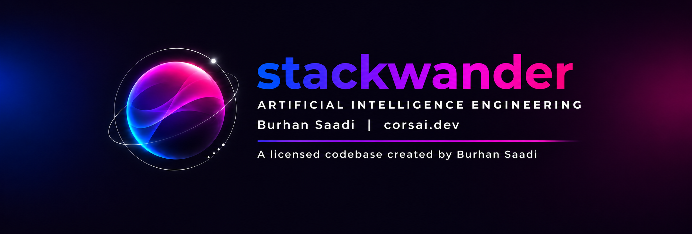

<!--
**stackwander/stackwander** is a ✨ _special_ ✨ repository because its `README.md` (this file) appears on your GitHub profile.

Here are some ideas to get you started:

- 🔭 I’m currently working on ...
- 🌱 I’m currently learning ...
- 👯 I’m looking to collaborate on ...
- 🤔 I’m looking for help with ...
- 💬 Ask me about ...
- 📫 How to reach me: ...
- 😄 Pronouns: ...
- ⚡ Fun fact: ...
-->

## Projects

🔭 A catalog of applications, projects, prototypes, and learning collections.

| Project name              | Description                                                                                                                                                                                                                                                                                                                                                                                                                                                              |
| ------------------------- | ------------------------------------------------------------------------------------------------------------------------------------------------------------------------------------------------------------------------------------------------------------------------------------------------------------------------------------------------------------------------------------------------------------------------------------------------------------------------ |
| [mobile-app-starter](https://github.com/stackwander/mobile-app-starter) | A reusable Expo + React Native starter app for Android & iOS with real account flows, sign-in, 2FA, sign-up, password reset, and account deletion behind one swappable Auth Backend seam with a fake backend. |
| AccessHub                 | Central authentication and fine-grained access management with hierarchical permissions, roles, API keys, TOTP MFA, Google sign-in, and REST/gRPC integration; built with FastAPI, PostgreSQL, and Next.js. Test client is a standalone Next.js consumer app for exercising authentication, MFA, account recovery, and permission checks, with a live request/response log. Walkthrough at [https://www.youtube.com/watch?v=kE_sCHIfYPs](https://). (Private Repo)|
| EcomBot                   | Conversational commerce suite with a React/TypeScript streaming chat UI, a FastAPI/LangGraph shopping agent using Mistral, and an OAuth-enabled MCP server for commerce and order-management tools. Includes session tokens, conversation memory, input guardrails, and a CSV-to-Pinecone FAQ pipeline using Cohere embeddings and reranking, incremental updates, deduplication, stale-vector cleanup, and retries. Walkthrough at [https://www.youtube.com/watch?v=NzVYxrlrKEo](https://)(Private Repo)                                                   |
| EcomBot Voice             | English/Urdu voice-commerce assistant using LiveKit and FastAPI, with browser calling, interruptions, commerce tools, and interchangeable speech and realtime-model pipelines. (Private Repo)  Walkthrough at [https://www.youtube.com/watch?v=fOtOTP9nQy0](https://) (Private Repo)                                                                                                                                                                                                                                                                                  |
| EcomBot Video Concept     | AI BOT with Video Avatar                                                                                                                                                                                                                                                                                                           |
| AI Expense Assist         | Expo/React Native expense-management app with receipt capture, budgets, an encrypted local ledger, and offline screens; integrates Firebase authentication, optional Firestore backup/synchronization, security rules, and device-token storage through an interchangeable backend adapter. (Private Repo)                                                                                                                                                                              |
| HaulEx                    | Prototype of a UK haulage exchange with customer job posting, contractor quotes, vehicle matching, fleet management, and delivery details. (Private Repo)                                                                                                                                                                                                                                                                                            |
| Convoy                    | CrewAI and FastAPI fleet-breakdown recovery demo with a React dashboard; dispatcher, planning, compliance, and communications agents compare options, request spend approval, retry execution, and retain preferences.   Walkthrough at [https://www.youtube.com/watch?v=FunTnCJWzb8](https://)                                                                                                                                                                                                                                                 |
| Agentic AI                | Python learning projects across OpenAI Agents SDK, AutoGen, CrewAI, and LangGraph covering tool use, multi-agent collaboration and handoffs, guardrails, structured output, memory and RAG, stateful graphs, ReAct and research loops, parallel workflows, human approval, code generation, planning and checkpoints, training/evaluation, MCP/A2A, observability, streaming, multimodal input, model configuration, and end-to-end pipelines.                  |
| Clean TypeScript Shop p4  | Educational Express/Prisma/MongoDB commerce API with Clean Architecture, users and JWT authentication, Redis-backed login state, and monitoring integrations.                                                                                                                                                                                                                                                                                                            |
| [Backend with Clean Architecture](https://github.com/stackwander/typescript-clean-ecommerce-api)  | TypeScript commerce REST API built with Express, Prisma, MongoDB, and Clean Architecture. Features transactional orders, inventory protection, API security, Docker, Kong, and observability with Prometheus, Grafana, and Loki. Tutorial at  [Tutorial video](https://www.youtube.com/watch?v=5aoPYlxv_MA&list=PLxhpwhPE6CABgYeed3YNs4HRCwPoln3j-&index=2)(backendcleants_p5)                                                                                                                                                                                                                                                                                               |
| [Backend with VSA and NestJS](https://github.com/stackwander/nestjs-vsa-ecommerce-api)           | A NestJS VSA e-commerce REST API built with TypeScript, PostgreSQL, and TypeORM. Features customer and product management, transactional orders, inventory locking, idempotent requests, API key authentication, and Docker deployment. [Tutorial video](https://www.youtube.com/watch?v=VgZGpkYw-c0&list=PLxhpwhPE6CABgYeed3YNs4HRCwPoln3j-&index=6)(NodeBackend_p6)                                                                                                                                                                                                                                                                                                                |
| [Backend NestJs/VSA Secure](https://github.com/stackwander/nestjs-secure-commerce-api) NestJS Secure Shop p6_1   | Secure NestJS VSA commerce API with JWT authentication, rotating refresh tokens, role-based access, transactional orders, inventory protection, and idempotency. Built with TypeScript, PostgreSQL, TypeORM, and Docker. [Tutorial video](https://www.youtube.com/watch?v=o3744kKmb0E&list=PLxhpwhPE6CABgYeed3YNs4HRCwPoln3j-&index=9)                                                                                                                                                                                                                                                                                                 |
| NestJS GraphQL Shop p7    | NestJS/Apollo/Prisma/PostgreSQL commerce API with code-first GraphQL, accounts, customer ownership checks, and transactional inventory protection.                                                                                                                                                                                                                                                                                                                       |
| React Dashboard p8        | Vite/React/Material UI learning frontend combining marketing pages, registration, login, and a customer dashboard; backend contract updates still require integration adjustments.                                                                                                                                                                                                                                                                                       |
| n8n Agent Workflows       | Exported automation workflows for research, email, calendar, project management, sales prospecting, and technical analysis; intended for import into n8n.                                                                                                                                                                                                                                                                                                                |
| Flowise Collection        | Flow wise export collection                                                                                                                                                                                                                                                                                                                                                                                                                                              |
| ML & DL                   | Comprehensive Machine Learning, Deep Learning prototypes converging nearly all aspects of subject                                                                                                                                                                                                                                                                                                                                                                        |
| Event Driven Backend starter template | Pull and start building highly scalable event driven backend with MCP extension for your next projects. |

## Technologies & packages

🚀 A subset used in projects

